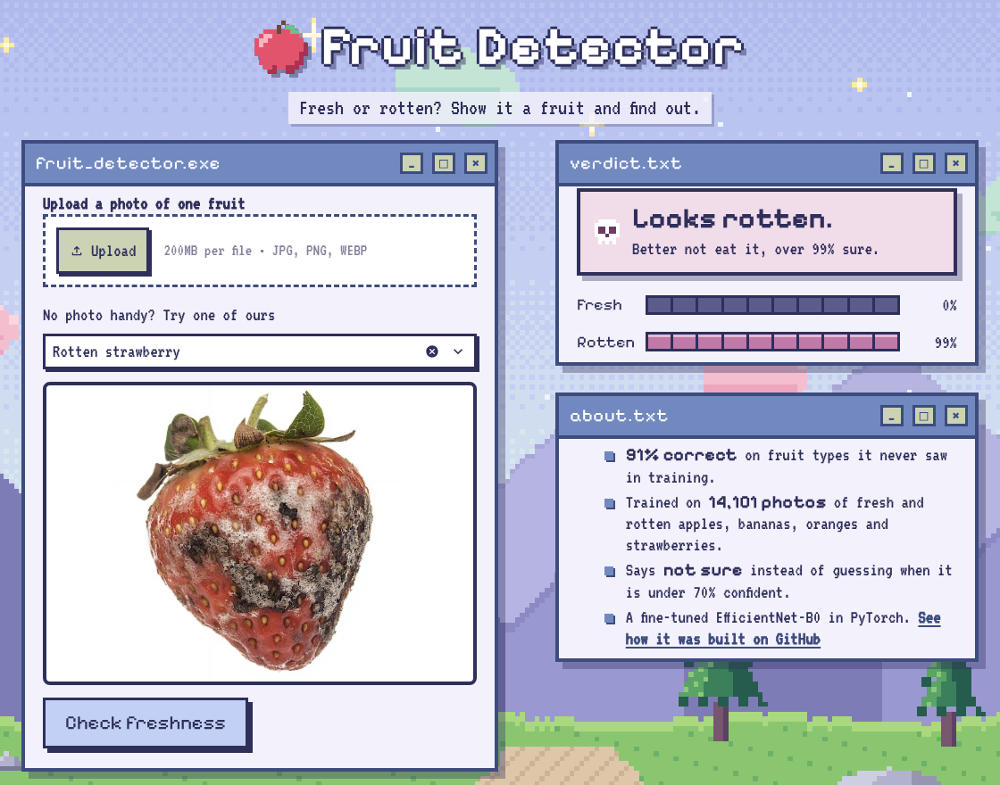

# 🍎 Fruit Detector

**Is it fresh or rotten?** Upload a photo of a fruit or vegetable and a fine-tuned
CNN gives a verdict with a calibrated confidence score, or says *"not sure"*
when it doesn't know.

**Live demo:** https://fruit-detector.streamlit.app



## Why this project is interesting: generalising to fruits it has never seen

The first version scored 100% validation accuracy and was still useless on new
fruits. Three reasons:

1. **7 training images.** A 2-image validation set can't detect overfitting.
2. **A background shortcut.** Every *fresh* photo was on a white studio
   background and every *rotten* one on grey or checkerboard, so the model could
   score perfectly just by checking the background.
3. **Validating on the same fruits it trained on.** A score on familiar fruits
   says nothing about an unfamiliar one.

The rebuild targets *generalisation*, not memorisation:

| Change | Why it helps |
| --- | --- |
| ~14k real photos (apple, banana, orange, strawberry) from public datasets | enough variety to learn what rot looks like |
| **Leave-one-fruit-out validation** | the score answers "can it judge a fruit it never saw?" |
| Balanced sampling per (fruit, label) | fruit identity carries no label information, so the model must learn mould, bruising and decay |
| Strong augmentation (crops, flips, rotation, lighting, blur, erasing) | breaks shortcuts tied to framing, background and camera |
| Two-stage transfer learning (head → top of backbone) at a low LR, label smoothing, weight decay, early stopping on val loss | stops it over-committing to the training fruits |
| Frozen BatchNorm kept in eval mode | the old code let BN statistics drift toward 7 screenshots |
| Temperature scaling + "not sure" below 70% confidence | honest confidence instead of confident wrong answers |

## Results

**Leave-one-fruit-out:** train on three fruits, then test on the fourth, which the
model has never seen (balanced accuracy, 800 test images per fruit; 231 for strawberry):

| Fruit held out | Old model (v1) | Fruit Detector |
| --- | --- | --- |
| apple | 61.8% | **88.8%** |
| banana | 78.4% | **93.9%** |
| orange | 62.1% | **89.6%** |
| strawberry | 62.7% | **90.8%** |
| **mean** | 66.3% | **90.8%** |

**Brand-new fruit types.** These 11 web photos include cherry, grapes, mango, pineapple,
raspberry, pear and tomato, none of which are in the training data: **11 / 11 correct**
(the v1 model got 9 / 11 even though 7 of them were its *training* images).

**Background shortcut check.** The 6 fresh photos were re-composited onto the grey,
checkerboard and dark backgrounds the rotten photos use: **18 / 18 still judged fresh**,
so the model looks at the fruit, not the backdrop.

Backbone comparison (frozen features + logistic regression, mean balanced accuracy on
the held-out fruit) used to pick the architecture: ResNet18 72%, ResNet50 76%,
EfficientNet-B3 81%, **EfficientNet-B0 81%**, MobileNetV3 83%. EfficientNet-B0 was
chosen for accuracy per megabyte (16 MB checkpoint, fast on CPU).

_Caveat: in the leave-one-fruit-out runs, early stopping also watched the held-out
fruit, so those numbers are slightly optimistic. The 11-photo and background tests
were never used for any training decision._

## Run it locally

```bash
python3 -m venv venv && source venv/bin/activate
pip install -r requirements.txt

python3 scripts/download_data.py      # ~2 GB of public images -> data/<fruit>/<fresh|rotten>/
python3 src/train.py --cv             # leave-one-fruit-out report (+ suggested --temperature)
python3 src/train.py --temperature 0.55   # final model -> checkpoints/best_model.pth
python3 src/inference.py samples/     # score the sample photos from the terminal
streamlit run app.py
```

Training uses an Apple-Silicon GPU (MPS) or CUDA automatically when one is available.

## Project layout

```
app.py                  Streamlit app: upload or pick a sample, get a verdict
src/ui.py               pixel-art look: colours, fonts, window chrome, sprites, verdict card
src/dataset.py          data layout, fruit-held-out splits, balanced sampler, augmentation
src/model.py            EfficientNet-B0 backbone + dropout/linear head (timm)
src/train.py            two-stage training, early stopping, temperature calibration
src/inference.py        load_model / predict_image shared by CLI and app
scripts/download_data.py  rebuilds the dataset from public GitHub mirrors
scripts/make_background.py  draws the pixel landscape -> assets/background.png
static/fonts/           Pixelify Sans + VT323 (served by Streamlit, no CDN needed)
samples/                photos used as one-click examples in the app
checkpoints/best_model.pth  trained weights used by the deployed app
```

## Data credits

- *Fruits fresh and rotten for classification* (Sriram Reddy Kalluri, Kaggle), via the
  [Bangkit-JKT2-D mirror](https://github.com/Bangkit-JKT2-D/fruits-fresh-rotten-classification)
- Strawberry / apple / banana images from
  [1RaghavM/Fruit-Freshness-Classification](https://github.com/1RaghavM/Fruit-Freshness-Classification)
- Pretrained backbone weights: [timm](https://github.com/huggingface/pytorch-image-models)
- Fonts: [Pixelify Sans](https://github.com/google/fonts/tree/main/ofl/pixelifysans) and
  [VT323](https://github.com/google/fonts/tree/main/ofl/vt323), SIL Open Font License (copies in `static/fonts/`)
- Pixel-art background and sprites: original, drawn in code (`scripts/make_background.py`, `src/ui.py`)

## Limitations

Trained on four fruit types photographed mostly against plain backgrounds. It
does best on a single, well-lit fruit filling most of the frame. Cluttered scenes,
cut fruit and produce that is *meant* to look dark (e.g. ripe plantains, aged
cheese) can fool it, which is why it reports when it's unsure.
